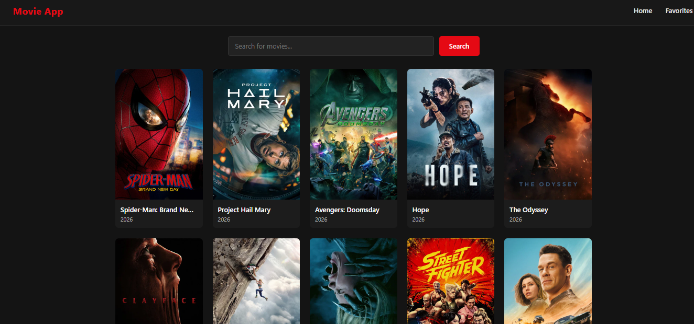
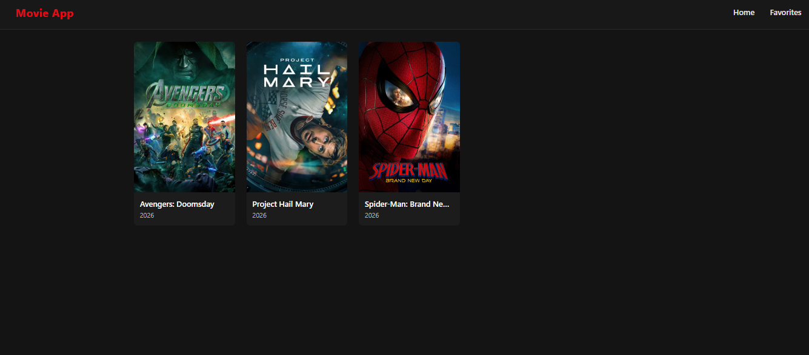

# 🎬 Movie App

A React + TypeScript app for browsing popular movies, searching titles, and saving your favorites, powered by the TMDB API.

## Screenshots

### Home



### Favorites



## Features

- **Popular movies**: the home page loads the current popular movies from TMDB
- **Search**: find any movie by title
- **Favorites**: add or remove a movie with the ♥ button on its poster
- **Saved between visits**: favorites are stored in `localStorage`, so they're still there after a reload
- **Favorites page**: all your saved movies in one place, with a message when the list is empty
- **Movie cards**: poster, title, and release year
- **Loading and error states** while fetching data

## Tech Stack

- [React 19](https://react.dev/)
- [TypeScript](https://www.typescriptlang.org/)
- [Vite](https://vite.dev/)
- [React Router](https://reactrouter.com/)
- [TMDB API](https://developer.themoviedb.org/)
- React Context API for favorites state

## Project Structure

```
src/
├── components/   # MovieCard, NavBar
├── contexts/     # MovieContext (favorites state)
├── css/          # Styles for each page and component
├── pages/        # Home, Favorites
├── services/     # api.ts (TMDB requests)
├── App.tsx       # Routes
└── main.tsx      # Entry point
```

## Getting Started

### Prerequisites

- [Node.js](https://nodejs.org/) installed
- A free TMDB API key from [themoviedb.org](https://www.themoviedb.org/settings/api)

### Installation

1. Clone the repository:

   ```bash
   git clone https://github.com/MohamadKrayyem/movie-app.git
   cd movie-app
   ```

2. Install dependencies:

   ```bash
   npm install
   ```

3. Create a `.env` file in the project root (copy `.env.example`) and add your TMDB API key:

   ```env
   VITE_API_KEY=your_tmdb_api_key
   ```

4. Start the development server:

   ```bash
   npm run dev
   ```

5. Open [http://localhost:5173](http://localhost:5173) in your browser.

## Scripts

| Command           | Description                       |
| ----------------- | --------------------------------- |
| `npm run dev`     | Start the development server      |
| `npm run build`   | Type-check and build for production |
| `npm run preview` | Preview the production build      |
| `npm run lint`    | Run ESLint                        |

## Author

**Mohamad Krayyem**: [github.com/MohamadKrayyem](https://github.com/MohamadKrayyem)
